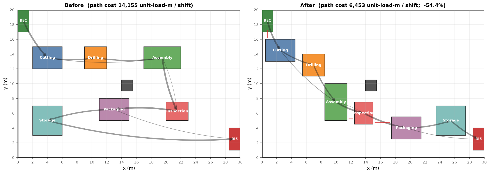

# Factory Layout Studio

Give it a picture of a factory floor plan. It finds the machines, measures the floor, and suggests a better
arrangement so that material travels less between machines.



*On the sample factory, total material travel drops by **54%**, while keeping 1 m aisles open.*

---

## How it works

1. **Read the plan** – an AI model finds every machine, loading dock and pillar in the image.
2. **Measure it** – the scale bar on the drawing turns pixels into metres.
3. **Model the flow** – you enter how much material moves between machines each shift.
4. **Optimise** – a search algorithm tries thousands of arrangements and keeps the one with the least travel.

---

## Get started

You need **Python 3.10+**.

```bash
pip install -r requirements.txt
python -m streamlit run app.py
```

The app opens in your browser. A trained model and sample floor plans are already included, so you can try it straight away.

### Using the app

| Step | Page | What to do |
|:-:|---|---|
| 1 | **Import floor plan** | Pick a sample plan or upload your own, then click **Use this layout**. |
| 2 | **Layout editor** | Check the detected machines. Fix positions, add anything missed, then **Save changes**. |
| 3 | **Material flow** | Set how many loads each product moves per shift. |
| 4 | **Optimize & export** | Click **Run optimization**. Download the new layout as CSV, PNG or JSON. |

---

## Results

| What was measured | Result |
|---|---|
| Material travel on the sample factory | 14,155 → 6,453 load-metres per shift (**−54%**) |
| AI model accuracy on test plans | **95%** (mAP@0.5) |
| Scale measurement error | **0.7%** |

All result numbers and charts are in the `outputs/` folder.

---

## Folder guide

| Folder / file | What's inside |
|---|---|
| `app.py` | The web app |
| `factory_ai/` | The core code (AI model, measuring, optimiser) |
| `scripts/` | Scripts to rebuild the data, retrain the model and re-run experiments |
| `tests/` | Automated tests |
| `data/` | Sample floor plans and their labels |
| `outputs/` | Trained model, result numbers and charts |

---

## Rebuild everything (optional)

Only needed if you want to regenerate the data or retrain the model.

```bash
python scripts/01_generate_data.py               # create 800 sample floor plans
python scripts/02_train_detector.py --epochs 16  # train the AI model (~30 min on a laptop)
python scripts/03_evaluate_detector.py           # measure model accuracy
python scripts/04_optimizer_experiments.py       # optimiser results and charts
python scripts/05_end_to_end_eval.py 40          # test the full pipeline
python -m pytest tests                           # run the tests
```

> On a computer with 8 GB of RAM, add `--batch 4` to the training command.
> To train on a free GPU, open `colab_run_all.ipynb` in Google Colab.

---

## Limitations

- The AI model was trained on computer-generated floor plans. It has not been tested on real factory drawings yet.
- Each plan can have only one machine of each type.
- Production volumes are example numbers, not real factory data.
- The 1 m clearance keeps aisles open but is not a full safety or fire-code check.

---

**Built with** Python · PyTorch · OpenCV · Streamlit
